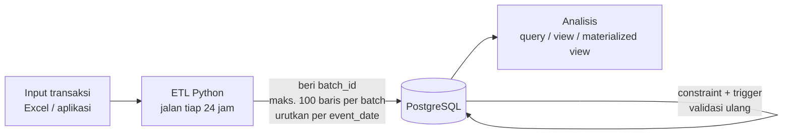
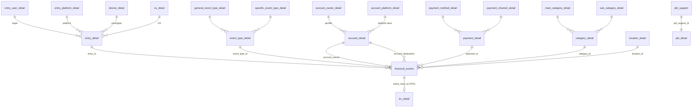

# Financial Events Ledger

Sistem pencatatan keuangan pribadi berbasis **event** (buku besar *append-only*) di atas **PostgreSQL**, dibangun untuk satu tujuan: menghasilkan **data yang rapi dan bisa dipercaya** supaya bisa dianalisis.

> **Status:** 🚧 *Work in progress.* Skema masih terus disempurnakan. Lihat bagian [Roadmap](#roadmap--todo).

---

## Daftar Isi

1. [Tujuan](#tujuan)
2. [Alur Data](#alur-data)
3. [Struktur Database](#struktur-database)
4. [Kode Kelas Kejadian](#kode-kelas-kejadian)
5. [Aturan Bisnis (UU Financial)](#aturan-bisnis-uu-financial)
6. [Validasi Otomatis](#validasi-otomatis)
7. [Role dan Hak Akses](#role-dan-hak-akses)
8. [Konvensi Penamaan](#konvensi-penamaan)
9. [Cara Menjalankan (Lokal)](#cara-menjalankan-lokal)
10. [Catatan Keamanan](#catatan-keamanan)
11. [Roadmap / TODO](#roadmap--todo)

---

## Tujuan

Proyek ini lahir dari tiga kebutuhan:

1. Belajar **analisis data**.
2. Punya **bahan data** sendiri untuk dianalisis.
3. Memahami **perilaku keuangan** pribadi.

Jadi sistem ini adalah *mesin penghasil data untuk analisis*, bukan aplikasi pembayaran. Prioritas utamanya: integritas data, jejak yang jelas, dan struktur yang siap dianalisis.

Prinsip desain yang dipakai:

- **Append-only.** Kejadian yang sudah tercatat tidak diubah. Kesalahan dikoreksi lewat kejadian baru (RSN lalu RVS).
- **Semua kejadian = perpindahan nilai dari satu akun ke akun lain.** Pihak luar (misalnya SPBU atau warung) juga dicatat sebagai akun dengan pemilik masing-masing.
- **`NULL` dihindari.** Angka `0` adalah nilai bisnis yang sah; kolom dibuat `NOT NULL` dan diisi `0`.
- **Dua lapis pengaman.** Python (ETL) merapikan dan menghitung, database memvalidasi ulang lewat *constraint* dan *trigger*.
- **Ledger hanya berisi kejadian.** Tabel ringkasan/snapshot dipisah dari buku besar.

---

## Alur Data



1. Transaksi dicatat per kejadian (saat ini lewat Excel yang strukturnya mencerminkan tabel database).
2. ETL Python berjalan terjadwal **setiap 24 jam**. Tugasnya memberi `batch_id` (satu batch menampung maksimal **100 baris**; sisanya masuk batch baru), mengurutkan baris berdasarkan `event_date`, lalu memasukkannya ke database.
3. Database memeriksa ulang aturan (format ID, urutan tanggal, rumus, dan lain-lain).
4. `saldo` dan `total_asset` tidak disimpan di ledger. Keduanya direncanakan menjadi *view* atau *materialized view*.

---

## Struktur Database

### Diagram Relasi (ER)



> `rcm_detail` dan `pkt_detail` **sengaja tidak terhubung** ke `financial_events`. Keduanya adalah snapshot hasil hitungan Python, bukan kejadian.

### Kelompok Tabel

| Kelompok | Tabel | Keterangan |
|---|---|---|
| **Fakta (ledger)** | `financial_events` | Inti sistem. Satu baris = satu kejadian. *Immutable*. |
| **Detail transaksi** | `trx_detail` | Lampiran per transaksi TRX (ukuran, tipe, URL file). Boleh dikoreksi. |
| **Snapshot analitik** | `rcm_detail` | Snapshot bulanan nilai akun investasi. *Immutable*. |
| | `pkt_detail` | Snapshot tahunan pertumbuhan kekayaan terhadap kondisi ekonomi. *Immutable*. |
| | `pkt_support` | Data pendukung `pkt_detail` (dibuat lebih dulu). Boleh dikoreksi. |
| **Penginput** | `entry_user_detail` | Orang yang menginput data (data pribadi, dienkripsi/di-hash). |
| | `entry_platform_detail`, `device_detail`, `os_detail` | Platform, perangkat, dan OS yang dipakai. |
| | `entry_detail` | "DNA penginput": gabungan unik dari user + platform + perangkat + OS. |
| **Akun** | `account_detail` | Akun = (mata uang, urutan, platform, pemilik). |
| | `account_owner_detail`, `account_platform_detail` | Pemilik dan platform akun (termasuk akun pihak luar). |
| **Klasifikasi** | `event_type_detail` (+ `general_*`, `specific_*`) | Jenis kejadian. |
| | `category_detail` (+ `main_*`, `sub_*`) | Kategori dan subkategori. |
| | `payment_detail` (+ `payment_method_*`, `payment_channel_*`) | Metode dan kanal pembayaran. |
| | `location_detail` | Lokasi sampai level kecamatan. |

### Kolom Penting di `financial_events`

| Kolom | Arti |
|---|---|
| `uuid` | Nomor urut internal (`bigserial`, bukan UUID sungguhan). |
| `batch_id` | Label keranjang dari ETL Python (maks. 100 baris per batch). |
| `entry_id` | "DNA penginput" saat data ditulis (`ETR-n`). |
| `written_at` / `event_date` | Kapan data **ditulis** vs kapan kejadiannya **terjadi**. Selisihnya bisa dipakai untuk mendeteksi penginput yang suka menunda. |
| `event_class_id` | Kelas kejadian, unik di seluruh sistem (lihat tabel di bawah). |
| `account_source` → `account_destination` | Arah perpindahan nilai. |
| `actual_amount`, `actual_currency` | Nominal asli dan mata uangnya. |
| `exchange_rate`, `base_currency`, `base_amount` | Kurs saat kejadian, mata uang acuan (selalu `IDR`), dan nominal terkonversi. |

---

## Kode Kelas Kejadian

Kolom `event_class_id` menggunakan prefix berikut:

| Kode | Kepanjangan | Fungsi |
|---|---|---|
| **TRX** | Transaksi / event | Kejadian sehari-hari. Memengaruhi saldo dan total aset sesuai jenis kejadian. |
| **RCC** | Reconciliation | Penyesuaian per akun untuk selisih (misalnya saat balancing akhir bulan karena salah ingat/salah catat). Dipakai juga saat nilai tiap akun investasi dihitung ulang: satu akun, satu RCC. |
| **RCM** | Reconciliation Market | Total penambahan atau pengurangan nilai moneter dari **semua akun investasi** (penjumlahan RCC khusus akun investasi, dihitung Python). |
| **PKT** | Pertumbuhan Kekayaan Tahunan | Kekayaan terhadap kondisi ekonomi pada saat snapshot dibuat. |
| **RSN** | Reversal Netral | Menetralkan input yang salah (menarik kembali nilai dari akun yang salah). |
| **RVS** | Reversal | Memasukkan ulang nilai yang benar setelah RSN. |

> Catatan: RCC, RSN, dan RVS adalah *kejadian* (baris di `financial_events`). `rcm_detail` dan `pkt_detail` adalah *snapshot* yang ditulis Python dan **tidak** menambah baris di ledger.

---

## Aturan Bisnis (UU Financial)

Aturan di sistem ini disebut **"UU Financial"** dan dapat direvisi bila syaratnya terpenuhi.

| Pasal | Isi |
|---|---|
| **Pasal 10 ayat 2** | Setiap transaksi ditulis **berurutan** sesuai kejadian aslinya. Bila penginput lupa urutan, tanggal, bulan, dan tahun tetap tidak boleh acak. Urutan dijaga **per penginput**; penginput berbeda boleh saling selang-seling. Tanggal yang sama diperbolehkan. |
| **Pasal 10 ayat 3** | Pengendalian ketat atas entri data: mencegah penginput asal-asalan atau menunda, serta memudahkan *debugging* (misalnya bila penginput tidak bisa mengakses aplikasi). Penginput yang malas dapat mengirim lewat email terlebih dulu atau ditegur langsung. Inilah alasan adanya `entry_detail` ("DNA penginput"). |
| **Pasal 10 ayat 4** | *[ISI: tambahkan bunyi pasal]* |
| **Pasal 11 ayat 1** | Setiap perhitungan valas **dikonversi ke IDR**. Alasan: mayoritas transaksi dalam IDR, domisili di Indonesia, dan operasional sehari-hari dalam IDR. Aset non-moneter dianggap **pengeluaran** dan naik-turun nilainya **tidak dicatat**. |
| **Pasal 11 ayat 5** | *[ISI: tambahkan bunyi pasal]* |

**Bila basis mata uang suatu hari diubah** (misalnya ke USD): pasal direvisi, lalu dibuat database baru dengan struktur yang sama (hanya penamaan kolom dan fungsi yang disesuaikan), saldo akhir database lama dibawa sebagai saldo awal, dan database lama diarsipkan.

---

## Validasi Otomatis

### Constraint

- **Format ID** diperiksa dengan regex pada setiap kolom ID (lihat [Konvensi Penamaan](#konvensi-penamaan)).
- **Mata uang acuan** hanya boleh `IDR` (`check (base_currency = 'IDR')`).
- **Nominal terkonversi:** `base_amount = round(actual_amount * exchange_rate, 2)`.
- **Tanggal:** `event_date >= 2026-01-01`.
- **Kombinasi unik** pada tabel kamus (misalnya lokasi, kategori, jenis kejadian, pembayaran, akun, dan "DNA penginput") supaya tidak ada duplikat.

### Trigger dan Fungsi

| Trigger | Tabel | Tugas |
|---|---|---|
| `trigger_format_date_financial_events` | `financial_events` | Menolak TRX yang tanggalnya lebih mundur dari TRX terakhir **penginput yang sama** (via `entry_detail`). |
| `trigger_rcm_detail` | `rcm_detail` | Menghitung ulang `*_growth` dan persentasenya terhadap bulan sebelumnya, lalu membandingkan dengan angka dari Python (toleransi 0,01). Bila nilai lama = 0, persentase = `sign(selisih) * 100`. |
| `trigger_net_worth_valas` | `pkt_detail` | Mencocokkan `net_worth_valas` dengan hasil `total_valas - kewajiban_valas` dari `pkt_support`. |
| `trigger_immutable_*` | `financial_events`, `rcm_detail`, `pkt_detail` | Menolak `UPDATE` dan `DELETE`, kecuali oleh `admin_database` atau `postgres`. |

> Tabel `pkt_support` dan `trx_detail` **sengaja tidak immutable** karena diisi penginput/developer dan mungkin perlu dikoreksi (misalnya tautan file yang salah).

### Aturan Pembulatan

Perbandingan angka hasil hitungan memakai **toleransi (`abs(selisih) <= batas`)**, bukan kesamaan persis, supaya perbedaan pembulatan tidak menolak data yang benar. Batas yang dipakai mengikuti ketelitian kolom: `0.01` untuk uang (2 desimal) dan `0.000001` untuk rasio (6 desimal). Di sisi Python, gunakan `Decimal` dengan aturan pembulatan yang sama dengan PostgreSQL (`ROUND_HALF_UP`).

---

## Role dan Hak Akses

| Role | Hak | Catatan |
|---|---|---|
| `admin_database` | Superuser | Administrasi saja; satu-satunya yang boleh mengubah tabel immutable (selain `postgres`). |
| `data_analyst` | `SELECT` semua tabel, **kecuali** `entry_user_detail` | Untuk analisis. |
| `backend_developer` | `SELECT`, `INSERT`, `UPDATE`, **kecuali** `SELECT` di `entry_user_detail` | `UPDATE` tetap ditolak trigger pada tabel immutable. |
| `etl_python` | `SELECT`, `INSERT` semua tabel + pakai sequence | Memasukkan data ke semua tabel. |
| `ml_python_system` | *(belum ada)* | Dicadangkan. |
| `llm_Cplus_system` | *(belum ada)* | Dicadangkan. |

---

## Konvensi Penamaan

**Prefix ID**

| Prefix | Tabel | | Prefix | Tabel |
|---|---|---|---|---|
| `OS-` | `os_detail` | | `PAY-` | `payment_detail` |
| `DVC-` | `device_detail` | | `AOWN-` | `account_owner_detail` |
| `EPLT-` | `entry_platform_detail` | | `APLT-` | `account_platform_detail` |
| `EUSR-` | `entry_user_detail` | | `ACC-` | `account_detail` |
| `ETR-` | `entry_detail` | | `GEVTP-` | `general_event_type_detail` |
| `LCT-` | `location_detail` | | `SEVTP-` | `specific_event_type_detail` |
| `MCAT-` | `main_category_detail` | | `EVTP-` | `event_type_detail` |
| `SCAT-` | `sub_category_detail` | | `PAC-` | `payment_channel_detail` |
| `CAT-` | `category_detail` | | `PAM-` | `payment_method_detail` |

Kelas kejadian memakai prefix `TRX-`, `RCC-`, `RCM-`, `PKT-`, `RSN-`, dan `RVS-`.

**Akhiran kolom**

- `_encryption`: kolom yang datanya direncanakan dienkripsi.
- `_hash`: kolom yang datanya di-hash.

**Istilah**

- *kewajiban* = liabilitas, *valas* = valuta asing, *bobot* = porsi, *saldo* = saldo kas, *tabungan* / *nabung* = akumulasi tabungan.

---

## Cara Menjalankan (Lokal)

Prasyarat: PostgreSQL terpasang di komputer lokal.

```bash
# 1. buat database latihan yang kosong
createdb financial_ledger

# 2. jalankan skema (ganti schema.sql dengan nama file skrip Anda)
psql -d financial_ledger -f schema.sql
```

**Peringatan:**

- Perintah `create role` berlaku untuk **seluruh server PostgreSQL**, bukan hanya satu database. Jalankan hanya di server lokal yang tidak dipakai orang lain.
- Password role pada skrip masih kosong. **Isi password yang kuat** sebelum dipakai di luar eksperimen.
- Skrip belum idempoten. Menjalankannya dua kali pada database yang sama akan menghasilkan error.

---

## Catatan Keamanan

- **Jangan** menaruh data keuangan asli (misalnya file Excel transaksi) di repositori publik. Gunakan `.gitignore` dan data contoh palsu.
- **Jangan** menaruh password, kunci enkripsi, atau string koneksi di repositori.
- `admin_database` adalah superuser: jangan dipakai untuk kegiatan sehari-hari.
- Kolom bertanda `_encryption` / `_hash` memuat data pribadi penginput dan dibatasi aksesnya dari `data_analyst` dan `backend_developer`.

---

## Roadmap / TODO

**Belum diputuskan / perlu dijawab**

- [ ] Isi kolom `_encryption`: teks asli atau hasil enkripsi? Ini menentukan apakah regex dan panjang `varchar` di `entry_user_detail` masih cocok.
- [ ] Arti dan tujuan `bobot_usd` (rumus saat ini selalu menghasilkan 1 atau 0).
- [ ] Rincian kolom dan aturan untuk RCC, RSN, dan RVS.
- [ ] Cara menghubungkan RCM ke RCC pembentuknya.
- [ ] Bunyi Pasal 10 ayat 4 dan Pasal 11 ayat 5 (isi di bagian [Aturan Bisnis](#aturan-bisnis-uu-financial)).

**Kandidat perbaikan skema**

- [ ] Presisi kurs: `exchange_rate` dan `rate_usd` menjadi `numeric(25, 10)`, serta `round(..., 2)` pada check `kewajiban_valas` (ditunda sampai kewajiban dipakai).
- [ ] `unique (rcm_date)` di `rcm_detail`; `unique (year)` di `pkt_support` dan `pkt_detail`.
- [ ] Aturan kurs IDR selalu 1: `check (actual_currency <> base_currency or exchange_rate = 1)`.
- [ ] `os_version_encryption` dibuat wajib diisi (atau `unique nulls not distinct`).
- [ ] Kolom waktu `created_at` di `rcm_detail` dan `pkt_detail`.
- [ ] Index pada kolom foreign key dan `event_date` (misalnya `financial_events (entry_id, event_date)`).
- [ ] `ALTER DEFAULT PRIVILEGES` agar tabel baru ikut mendapat hak akses.
- [ ] Unique untuk tabel kamus yang tersisa; *comment on* untuk mencatat "pasal" langsung di database.

**Pengembangan**

- [ ] Uji skrip secara penuh di PostgreSQL lokal dan siapkan data contoh.
- [ ] Implementasi ETL Python (pemberian `batch_id`, pengurutan, `Decimal`, pencegahan saldo minus).
- [ ] View / materialized view untuk `saldo` dan `total_asset`.
- [ ] Alat migrasi (misalnya Alembic), backup rutin (`pg_dump`), dan aplikasi frontend.
- [ ] Hak akses untuk `ml_python_system` dan `llm_Cplus_system`.
