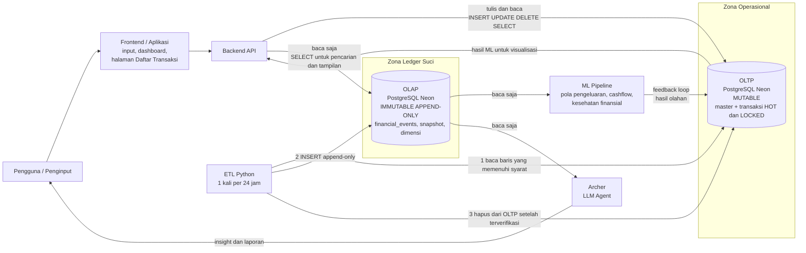
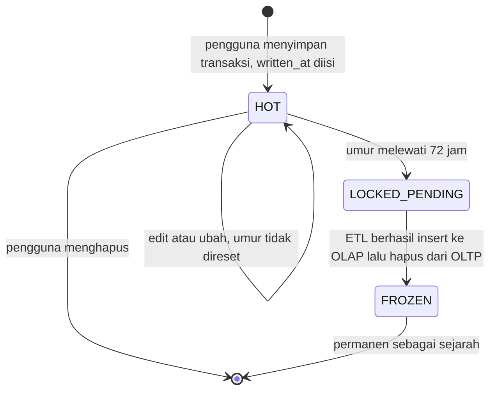
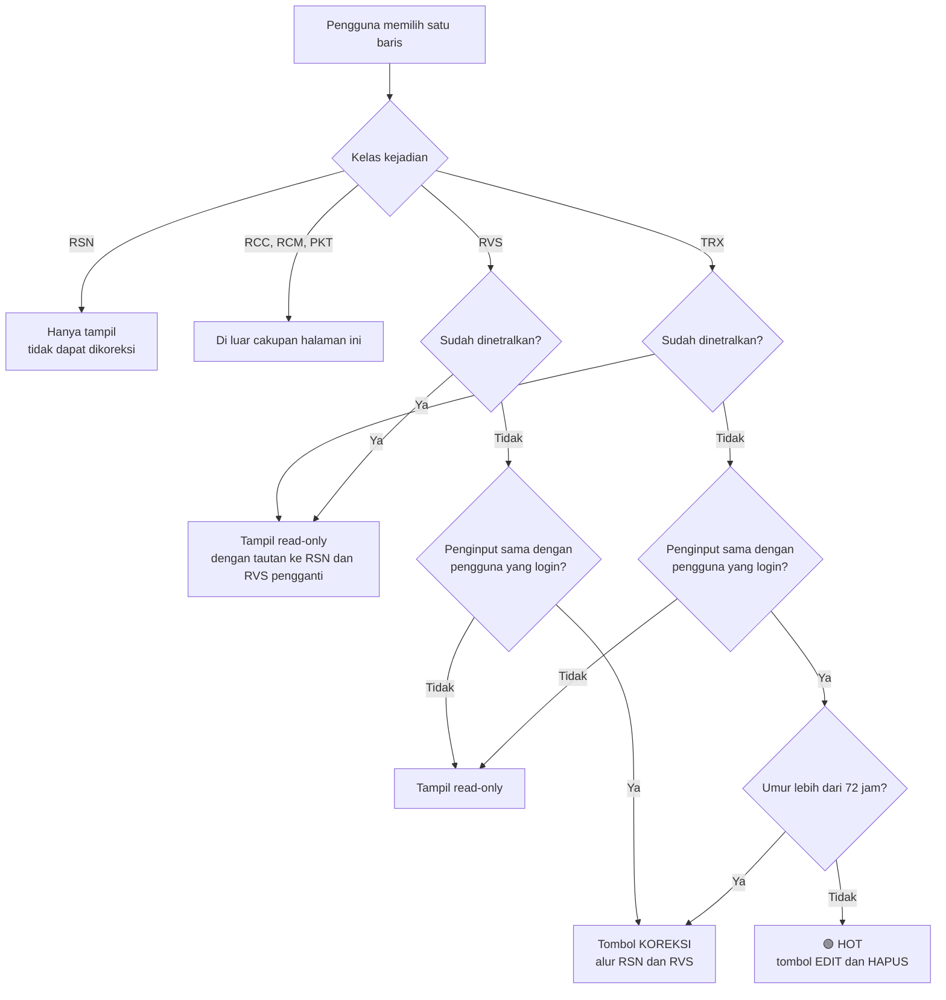
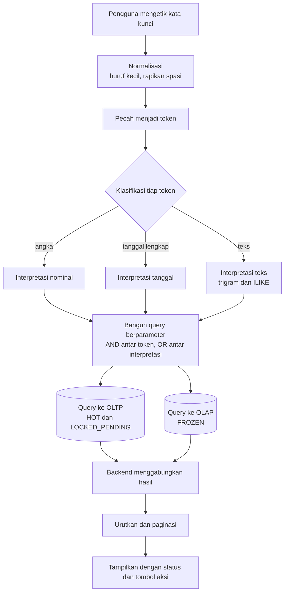
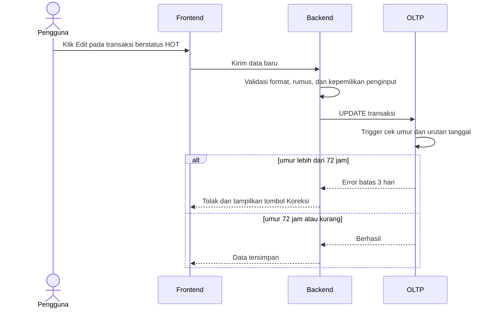
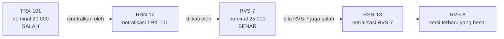
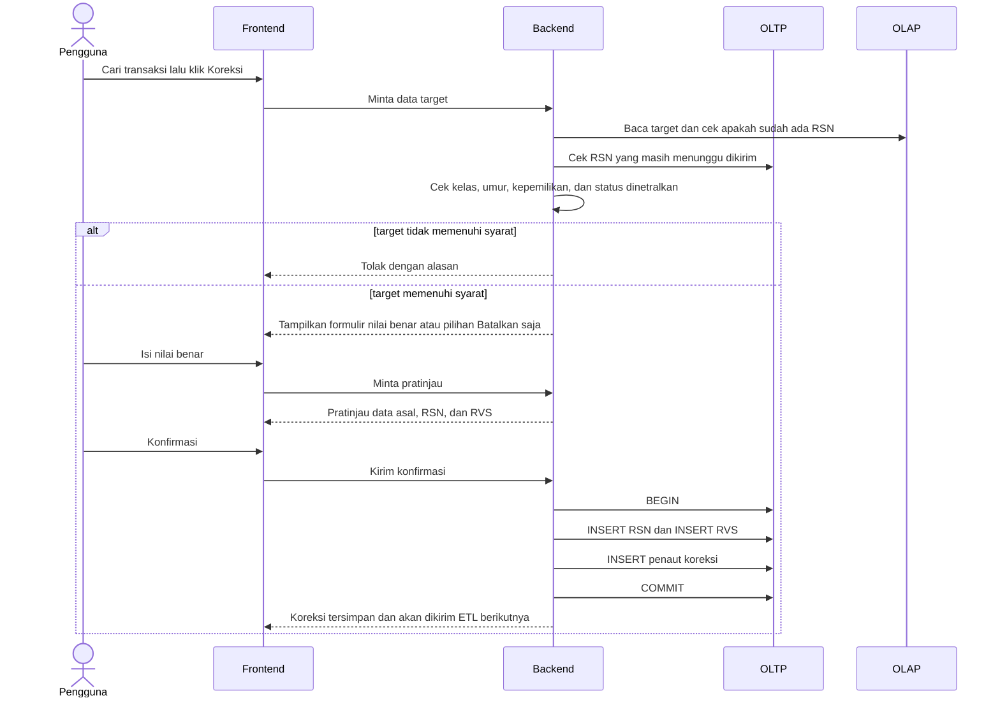
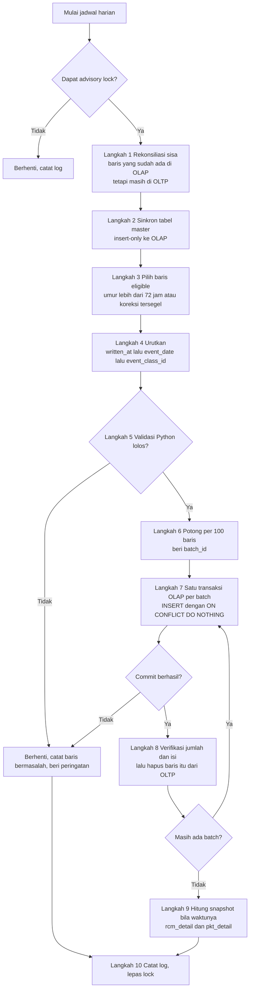
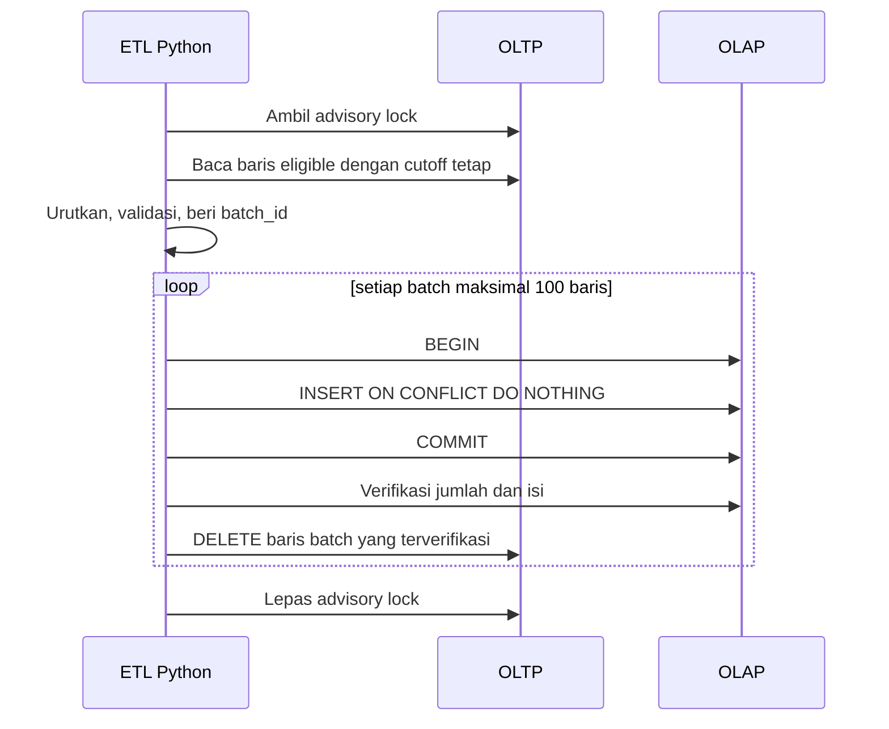
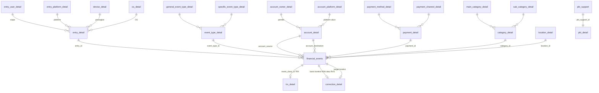

# Ledger Suci — Financial Events Ledger

Sistem pencatatan keuangan pribadi berbasis **event** (buku besar *append-only*) di atas **PostgreSQL (Neon)** dengan strategi **Dual Database (OLTP + OLAP)**, dibangun untuk satu tujuan: menghasilkan **data yang rapi, bisa dipercaya, dan siap dianalisis**.

> **Status:** 🚧 *Work in progress.* Skema dan arsitektur masih disempurnakan. Bagian yang belum diputuskan dicatat terbuka di [Open Items](#21-open-items-belum-diputuskan) dan [Roadmap](#22-roadmap).

---

## 0. Informasi Dokumen

| Atribut | Nilai |
|---|---|
| Nama dokumen | README — Ledger Suci (Financial Events Ledger) |
| Versi | 0.2.0-draft |
| Tanggal | 2026-10-20 |
| Status | Draft, menunggu konfirmasi pada bagian [Keputusan Desain](#20-keputusan-desain-dan-resolusi-konflik-antar-sumber) |
| Bahasa | Indonesia |
| Penerapan | Proyek pribadi, dirancang dengan standar dokumentasi setara *mid-enterprise* agar bisa tumbuh |

**Sumber yang digabung dalam dokumen ini**

| Kode | Sumber | Isi utama |
|---|---|---|
| **[A]** | README skema *Financial Events Ledger* | Tabel, kolom, kode kelas kejadian, UU Financial, constraint, trigger, role |
| **[B]** | Dokumen arsitektur *Ledger Suci* | Dual Database, ETL, grace period 3 hari, Kotak Pintar, ML dan Archer |
| **[C]** | Spesifikasi halaman daftar transaksi | Tombol menuju daftar transaksi, aturan edit/hapus 3 hari, RSN dan RVS, fitur pencarian |
| **[D-xx]** | Keputusan penyusun dokumen ini | Hal yang tidak tertulis di sumber, atau sumber saling bertentangan. Daftar lengkap di [bagian 20](#20-keputusan-desain-dan-resolusi-konflik-antar-sumber) |

**Konvensi kata normatif** (mengacu RFC 2119): **WAJIB** = harus dipenuhi tanpa pengecualian. **DILARANG** = tidak boleh terjadi. **BOLEH** = opsional. **DISARANKAN** = sebaiknya, boleh ditinggalkan dengan alasan.

**Konvensi penanda**: 🟢 = status HOT, 🟠 = status LOCKED_PENDING, 🔒 = status FROZEN.

---

## Daftar Isi

0. [Informasi Dokumen](#0-informasi-dokumen)
1. [Ringkasan](#1-ringkasan)
2. [Tujuan, Ruang Lingkup, dan Di Luar Lingkup](#2-tujuan-ruang-lingkup-dan-di-luar-lingkup)
3. [Glosarium](#3-glosarium)
4. [Prinsip Desain](#4-prinsip-desain)
5. [Arsitektur](#5-arsitektur)
6. [Siklus Hidup Transaksi dan Aturan 3 Hari](#6-siklus-hidup-transaksi-dan-aturan-3-hari)
7. [Halaman Daftar Transaksi (Kotak Pintar)](#7-halaman-daftar-transaksi-kotak-pintar)
8. [Mekanisme Koreksi RSN dan RVS](#8-mekanisme-koreksi-rsn-dan-rvs)
9. [Pipeline ETL](#9-pipeline-etl)
10. [Struktur Database](#10-struktur-database)
11. [Kode Kelas Kejadian](#11-kode-kelas-kejadian)
12. [Aturan Bisnis (UU Financial)](#12-aturan-bisnis-uu-financial)
13. [Validasi Otomatis](#13-validasi-otomatis)
14. [Role dan Hak Akses](#14-role-dan-hak-akses)
15. [Konvensi Penamaan](#15-konvensi-penamaan)
16. [Persyaratan Non-Fungsional](#16-persyaratan-non-fungsional)
17. [Penanganan Error dan Kasus Tepi](#17-penanganan-error-dan-kasus-tepi)
18. [Cara Menjalankan (Lokal)](#18-cara-menjalankan-lokal)
19. [Catatan Keamanan](#19-catatan-keamanan)
20. [Keputusan Desain dan Resolusi Konflik Antar Sumber](#20-keputusan-desain-dan-resolusi-konflik-antar-sumber)
21. [Open Items (Belum Diputuskan)](#21-open-items-belum-diputuskan)
22. [Roadmap](#22-roadmap)
23. [Lampiran A — Contoh SQL Ilustratif](#lampiran-a--contoh-sql-ilustratif)
24. [Lampiran B — Kriteria Penerimaan (Acceptance Criteria)](#lampiran-b--kriteria-penerimaan-acceptance-criteria)

---

## 1. Ringkasan

Sistem ini mencatat setiap kejadian keuangan sebagai **perpindahan nilai dari satu akun ke akun lain**. Data dibagi menjadi dua database PostgreSQL dengan sifat berbeda:

| | **OLTP** (operasional) | **OLAP** (Ledger Suci) |
|---|---|---|
| Sifat data | *Mutable* (bisa diedit dan dihapus, dalam batas waktu) | *Immutable* dan *append-only* |
| Isi | Tabel master + transaksi harian yang masih "cair" | Fakta dan event yang sudah dibekukan + snapshot analitik |
| Penulis | Backend aplikasi | **Hanya** ETL Python |
| Pembaca | Backend, ETL | Backend (baca saja), analis, ML, Archer |

### Aturan inti dalam satu tabel

| Umur transaksi (dihitung dari `written_at`) | Lokasi | Yang boleh dilakukan pengguna |
|---|---|---|
| **0 sampai 72 jam** (≤ 3 hari) | OLTP | Edit, ubah, hapus langsung 🟢 |
| **Lebih dari 72 jam**, belum dikirim ETL | OLTP | Tidak boleh edit/hapus. Hanya koreksi lewat **RSN + RVS** 🟠 |
| Sudah dikirim ETL | OLAP | Tidak boleh edit/hapus. Hanya koreksi lewat **RSN + RVS** 🔒 |

> **"3 hari" selalu berarti 3 × 24 jam = 72 jam**, bukan "3 hari kalender". Batas dicek di server database, bukan di perangkat pengguna. Penjelasan lengkap di [bagian 6](#6-siklus-hidup-transaksi-dan-aturan-3-hari).

---

## 2. Tujuan, Ruang Lingkup, dan Di Luar Lingkup

### 2.1 Tujuan

Proyek ini lahir dari tiga kebutuhan:

1. Belajar **analisis data**.
2. Punya **bahan data** sendiri untuk dianalisis.
3. Memahami **perilaku keuangan** pribadi.

Jadi sistem ini adalah *mesin penghasil data untuk analisis*, bukan aplikasi pembayaran. Prioritas: **integritas data**, **jejak audit yang jelas**, dan **struktur yang siap dianalisis**.

### 2.2 Ruang lingkup (termasuk)

- Pencatatan kejadian keuangan (TRX) dan koreksinya (RSN, RVS).
- Penyesuaian dan snapshot analitik (RCC, RCM, PKT).
- Pipeline ETL dari OLTP ke OLAP.
- Halaman aplikasi untuk melihat, mencari, mengedit, menghapus, dan mengoreksi transaksi.
- Pembacaan data oleh analisis SQL, pipeline Machine Learning, dan agen LLM *Archer*.

### 2.3 Di luar lingkup (tidak termasuk)

- Pemrosesan pembayaran atau integrasi bank.
- Pencatatan naik-turun nilai aset non-moneter (lihat Pasal 11 ayat 1).
- Koreksi atas baris RCC, RCM, dan PKT lewat halaman koreksi (lihat [OI-06](#21-open-items-belum-diputuskan)).
- Dukungan multi-mata-uang basis. Basis mata uang **selalu IDR**.

---

## 3. Glosarium

| Istilah | Arti dalam dokumen ini |
|---|---|
| **OLTP** | Database operasional. Tempat input harian. Data bisa diubah dalam batas 72 jam. |
| **OLAP** | Database analitik/gudang data. Disebut juga **Ledger Suci**. Data terkunci. |
| **Ledger / buku besar** | Tabel `financial_events`: satu baris = satu kejadian. |
| **Append-only** | Hanya boleh menambah baris. Tidak ada `UPDATE`/`DELETE` pada data yang sudah tercatat. |
| **Immutable** | Tidak bisa diubah. Ditegakkan trigger; pengecualian hanya `admin_database` dan `postgres`. |
| **Grace period** | Masa tenggang 72 jam setelah transaksi ditulis, saat pengguna masih bebas mengedit/menghapus. |
| **HOT / LOCKED_PENDING / FROZEN** | Tiga status transaksi (lihat [bagian 6](#6-siklus-hidup-transaksi-dan-aturan-3-hari)). |
| **ETL** | Proses Python yang memindahkan data dari OLTP ke OLAP. |
| **Penginput** | Orang yang memasukkan data (`entry_user_detail`). Bisa lebih dari satu orang. |
| **DNA penginput** | `entry_detail` (`ETR-n`): gabungan unik penginput + platform + perangkat + OS saat data ditulis. |
| **`event_class_id`** | ID kejadian yang unik di seluruh sistem, berprefiks `TRX-`, `RCC-`, `RSN-`, `RVS-`, dan seterusnya. |
| **RSN** | *Reversal Netral*: kejadian baru yang menetralkan (membatalkan efek) kejadian lama yang salah. |
| **RVS** | *Reversal*: kejadian baru yang memasukkan ulang nilai yang **benar** setelah RSN. |
| **Kotak Pintar** | Nama fitur pencarian + koreksi pada halaman daftar transaksi (*Smart Correction Box*). |
| **`written_at`** | Waktu data **pertama kali ditulis** ke OLTP (jam server database). Dasar penghitungan umur. |
| **`event_date`** | Tanggal kejadian di dunia nyata. Dasar laporan keuangan. |
| **`frozen_at`** | Waktu baris masuk ke OLAP oleh ETL. |
| **Snapshot** | Tabel hasil hitungan Python (`rcm_detail`, `pkt_detail`). Bukan kejadian. |
| **Valas** | Valuta asing. |
| **Archer** | Agen LLM yang membaca OLAP untuk memberi insight kepada pengguna. |
| **pg_trgm** | Ekstensi PostgreSQL untuk pencarian kemiripan teks (trigram). |

---

## 4. Prinsip Desain

1. **Append-only di ledger.** Kejadian yang sudah dibekukan tidak diubah. Kesalahan dikoreksi lewat kejadian baru (RSN lalu RVS).
2. **Semua kejadian = perpindahan nilai dari satu akun ke akun lain.** Pihak luar (SPBU, warung, dan lain-lain) juga dicatat sebagai akun dengan pemilik masing-masing.
3. **`NULL` dihindari.** Angka `0` adalah nilai bisnis yang sah; kolom dibuat `NOT NULL` dan diisi `0`.
4. **Dua lapis pengaman.** Python (ETL) merapikan, memvalidasi, dan menghitung. Database memvalidasi ulang lewat *constraint* dan *trigger*. Aturan penting **WAJIB** ditegakkan di database, tidak boleh hanya di UI.
5. **Ledger hanya berisi kejadian.** Tabel ringkasan/snapshot dipisah dari buku besar.
6. **Satu arah.** Data mengalir Frontend → OLTP → ETL → OLAP → ML/Archer. Tidak ada jalur tulis lain ke OLAP.
7. **Jejak audit tidak boleh hilang.** Koreksi selalu tampak sebagai baris baru yang berada *setelah* baris asalnya.
8. **Zero Trust pada role.** Setiap role hanya memegang hak minimum yang dibutuhkan ([bagian 14](#14-role-dan-hak-akses)).

---

## 5. Arsitektur

### 5.1 Diagram arsitektur



### 5.2 Tanggung jawab komponen

| Komponen | Tanggung jawab | **DILARANG** |
|---|---|---|
| Frontend | Input, dashboard, halaman Daftar Transaksi, menampilkan status 🟢🟠🔒 | Menghitung status sendiri sebagai satu-satunya sumber kebenaran; frontend hanya menampilkan status dari backend |
| Backend API | Autentikasi, validasi, CRUD ke OLTP, membaca OLAP, menggabungkan hasil pencarian | Menulis ke OLAP |
| OLTP | Menyimpan master dan transaksi dalam masa 72 jam (serta yang menunggu dikirim), menegakkan batas 72 jam lewat trigger | Menyimpan histori jangka panjang |
| ETL Python | Memvalidasi, memberi `batch_id`, memindahkan data ke OLAP, menghapus dari OLTP setelah terverifikasi, menghitung snapshot | Mengubah isi data selain memberi `batch_id` dan `frozen_at` |
| OLAP | Menyimpan sejarah absolut | Menerima `UPDATE`/`DELETE` pada tabel immutable |
| ML Pipeline | Membaca OLAP, menulis hasil ke tabel khusus di OLTP | Menulis ke OLAP |
| Archer | Membaca OLAP lewat query terkontrol, menyajikan insight | Menulis ke database mana pun |

### 5.3 Jalur input saat ini

Saat ini transaksi masih dicatat lewat **Excel** yang strukturnya mencerminkan tabel database. Target akhir: input lewat Frontend. Cara data Excel masuk ke OLTP selama masa transisi belum diputuskan ([OI-09](#21-open-items-belum-diputuskan)).

---

## 6. Siklus Hidup Transaksi dan Aturan 3 Hari

### 6.1 Definisi umur

- **Umur** = `clock_timestamp()` server database **dikurangi** `written_at` transaksi.
- `written_at` diisi **sekali** saat baris pertama kali ditulis ke OLTP, memakai jam server database (bukan jam perangkat pengguna). Disimpan sebagai `timestamptz` (UTC) dan ditampilkan dalam WIB (Asia/Jakarta).
- **Mengedit transaksi TIDAK mengubah `written_at`.** Umur tidak pernah direset (mencegah penundaan batas tanpa akhir). [D-03]
- Batas: umur **≤ 72 jam 00 menit 00 detik** = masih HOT. Umur **> 72 jam** = terkunci.
- Umur **tidak** dihitung dari `event_date`. Alasannya: penginput boleh memasukkan kejadian yang terjadi beberapa hari lalu; jika umur dihitung dari `event_date`, transaksi itu langsung terkunci saat dibuat. [D-03]

### 6.2 Diagram status



### 6.3 Tabel status

| Status | Lokasi | Kondisi | Edit / hapus langsung | Cara mengubah |
|---|---|---|---|---|
| 🟢 **HOT** | OLTP | Umur ≤ 72 jam | **Boleh** | Edit atau hapus langsung |
| 🟠 **LOCKED_PENDING** | OLTP | Umur > 72 jam dan belum diambil ETL (lama tinggal di status ini kira-kira sampai satu siklus ETL, yaitu 24 jam; lebih lama bila ETL gagal) | **DILARANG** (ditolak trigger) | RSN + RVS |
| 🔒 **FROZEN** | OLAP | Sudah dikirim ETL | **DILARANG** (ditolak trigger immutable) | RSN + RVS |

Status tambahan yang **diturunkan** (tidak disimpan sebagai kolom): **"Sudah dinetralkan"**, yaitu transaksi yang sudah ditunjuk oleh sebuah RSN. Status ini dihitung dari ada/tidaknya baris penaut koreksi ([bagian 10.5](#105-usulan-tabel-penaut-koreksi-correction_detail)), karena baris OLAP tidak boleh diubah.

### 6.4 Aturan waktu: ringkasan parameter

| Parameter | Nilai | Sumber |
|---|---|---|
| `GRACE_PERIOD` | 72 jam (3 × 24 jam) | [B], [C] |
| `ETL_INTERVAL` | 1 kali per 24 jam | [A]; lihat [D-02](#20-keputusan-desain-dan-resolusi-konflik-antar-sumber) |
| `BATCH_SIZE_MAX` | 100 baris per `batch_id` | [A] |
| Zona waktu simpan | UTC (`timestamptz`) | [D-15] |
| Zona waktu tampil | WIB (Asia/Jakarta) | [D-15] |

> `GRACE_PERIOD` dan `ETL_INTERVAL` adalah **dua parameter yang berbeda**. `GRACE_PERIOD` menentukan kapan pengguna kehilangan hak edit. `ETL_INTERVAL` menentukan seberapa sering pemindahan dijalankan.

---

## 7. Halaman Daftar Transaksi (Kotak Pintar)

### 7.1 Deskripsi

Di halaman aplikasi terdapat **sebuah tombol** yang membawa pengguna ke halaman **Daftar Transaksi/Event**, yaitu daftar transaksi yang akan (atau sudah) masuk ke database immutable. Halaman ini memuat fitur **pencarian** sehingga pengguna dapat menemukan transaksi yang ingin diubah hanya dengan mengetik deskripsi, nominal, atau hal lain yang berhubungan dengan transaksi tersebut.

### 7.2 Diagram keputusan saat pengguna memilih satu baris



### 7.3 Sketsa tampilan (wireframe)

```
┌────────────────────────────────────────────────────────────────────────────┐
│ DAFTAR TRANSAKSI / EVENT                                                   │
│                                                                            │
│ [ Cari: deskripsi, nominal, tanggal, akun, kategori ...        ] [ Cari ]  │
│                                                                            │
├──────────┬────────────┬──────────────────┬───────────────┬────────┬────────┤
│ ID       │ Tanggal    │ Deskripsi        │ Nominal (IDR) │ Status │ Aksi   │
├──────────┼────────────┼──────────────────┼───────────────┼────────┼────────┤
│ TRX-120  │ 2026-10-19 │ Bensin SPBU      │ 20.000        │ 🟢 HOT │ Edit   │
│          │            │                  │               │        │ Hapus  │
│ TRX-110  │ 2026-10-15 │ Makan siang      │ 35.000        │ 🟠     │ Koreksi│
│ TRX-101  │ 2026-10-10 │ Bensin SPBU      │ 20.000        │ 🔒     │ Koreksi│
│ RSN-12   │ 2026-10-10 │ Netralisasi 101  │ 20.000        │ 🔒     │ —      │
└──────────┴────────────┴──────────────────┴───────────────┴────────┴────────┘
```

### 7.4 Persyaratan fungsional (FR)

| ID | Persyaratan |
|---|---|
| **FR-01** | Aplikasi **WAJIB** menyediakan satu tombol yang membuka halaman Daftar Transaksi. |
| **FR-02** | Daftar **WAJIB** menggabungkan baris dari OLTP (HOT dan LOCKED_PENDING) dan OLAP (FROZEN). Karena OLTP dan OLAP adalah dua database terpisah, penggabungan dilakukan di backend, bukan lewat join lintas database. |
| **FR-03** | Status setiap baris **WAJIB** dihitung di server (backend/database) berdasarkan `written_at` dan lokasi baris. Frontend hanya menampilkan. |
| **FR-04** | Pencarian **WAJIB** tersedia sesuai [spesifikasi pencarian](#75-spesifikasi-pencarian). |
| **FR-05** | Transaksi 🟢 HOT **BOLEH** diedit (semua kolom bisnis kecuali yang tercantum di [7.6](#76-kolom-yang-boleh-dan-tidak-boleh-diedit)). |
| **FR-06** | Transaksi 🟢 HOT **BOLEH** dihapus setelah pengguna menekan konfirmasi. |
| **FR-07** | Transaksi 🟠/🔒 **DILARANG** diedit atau dihapus. Satu-satunya jalan adalah **Koreksi** (RSN + RVS). |
| **FR-08** | Larangan pada FR-07 **WAJIB** ditegakkan di dua lapis: UI (tombol edit/hapus tidak tampil) **dan** database (trigger menolak). |
| **FR-09** | Hanya kelas **TRX** dan **RVS** yang dapat menjadi target koreksi. [D-10] |
| **FR-10** | Sebelum koreksi disimpan, sistem **WAJIB** menampilkan pratinjau: data asal, RSN yang akan dibuat, RVS yang akan dibuat. |
| **FR-11** | Pembuatan RSN dan RVS **WAJIB** atomik: keduanya tersimpan, atau tidak sama sekali. |
| **FR-12** | Bila saat pengguna menyimpan editan ternyata umur transaksi sudah melewati 72 jam, server **WAJIB** menolak dan menampilkan pesan: *"Transaksi ini sudah berumur lebih dari 3 hari. Gunakan tombol Koreksi."* |
| **FR-13** | Pengguna **hanya boleh** mengedit, menghapus, dan mengoreksi transaksi yang ia sendiri tulis (penginput yang sama). Baris milik penginput lain tampil read-only. [D-09] |
| **FR-14** | Baris yang sudah dinetralkan **WAJIB** diberi tanda dan tautan ke RSN serta RVS penggantinya. |

### 7.5 Spesifikasi pencarian

**Tujuan.** Pengguna mengetik apa saja yang ia ingat tentang transaksi, lalu sistem menampilkan kandidat terbaik.

**Aturan interpretasi input** [D-13]:

| Aspek | Aturan |
|---|---|
| Pemisahan kata | Input dipecah menjadi token berdasarkan spasi. Token berisi 1 karakter diabaikan. |
| Logika antar token | **AND**: sebuah baris hanya muncul bila **setiap** token cocok dengan setidaknya satu kolom yang dicari. |
| Logika dalam satu token | **OR** antar interpretasi (nominal, tanggal, teks). |
| Angka murni | Selalu diinterpretasi sebagai **nominal**, termasuk `2026`. |
| Format nominal | Konvensi Indonesia: **titik = pemisah ribuan**, **koma = desimal**. `20.000`, `20000`, `Rp20.000`, dan `Rp 20.000,00` semuanya = 20000. Singkatan seperti `rb`, `k`, `jt` **tidak didukung**. |
| Pencocokan nominal | Sama persis dengan `actual_amount` **atau** `base_amount`. |
| Format tanggal | Hanya tanggal lengkap: `yyyy-mm-dd`, `dd/mm/yyyy`, `dd-mm-yyyy`. Format `dd/mm/yyyy` dibaca hari-bulan-tahun. Dicocokkan ke `event_date` (bukan `written_at`). Nama bulan tidak didukung. |
| Teks | Dicocokkan secara **toleran salah ketik** (kemiripan trigram `pg_trgm`) **dan** sebagai potongan kata (`ILIKE`), tanpa membedakan huruf besar/kecil. Karakter khusus `%` dan `_` pada input **WAJIB** di-escape. |
| Input kosong | Menampilkan semua baris, terbaru lebih dulu. |

**Kolom yang dicari (teks)**: `description`, `event_class_id`, nama pemilik dan platform akun (asal dan tujuan), kategori dan subkategori, jenis kejadian (umum dan spesifik), metode dan kanal pembayaran, lokasi sampai kecamatan. Data pribadi penginput (`entry_user_detail`) **tidak** dicari.

**Urutan hasil** (deterministik): (1) jumlah token yang cocok penuh, menurun; (2) skor kemiripan tertinggi, menurun; (3) `event_date` menurun; (4) `event_class_id` menurun.

**Ukuran hasil**: 50 baris per halaman, dengan paginasi.



### 7.6 Kolom yang boleh dan tidak boleh diedit

Berlaku untuk transaksi 🟢 HOT.

| Kolom | Boleh diedit? | Catatan |
|---|---|---|
| `event_date` | Ya | Tetap tunduk pada aturan urutan tanggal ([7.7](#77-validasi-saat-edit-transaksi-hot)) |
| `account_source`, `account_destination` | Ya | |
| `actual_amount`, `actual_currency`, `exchange_rate` | Ya | `base_amount` dihitung ulang = `round(actual_amount * exchange_rate, 2)` |
| `event_type_id`, `category_id`, `payment_id`, `location_id` | Ya | |
| `description` | Ya | |
| `trx_detail` (ukuran, tipe, URL file) | Ya | |
| `event_class_id` | **Tidak** | ID tetap seumur hidup |
| `written_at` | **Tidak** | Ditolak trigger bila diubah |
| `entry_id` | **Tidak** | DNA penginput saat penulisan pertama tidak boleh berubah |
| `base_currency` | **Tidak** | Selalu `IDR` |

### 7.7 Validasi saat edit transaksi HOT

Semua constraint di [bagian 13](#13-validasi-otomatis) berlaku. Tambahan khusus OLTP [D-12]:

1. **Urutan tanggal (Pasal 10 ayat 2).** `event_date` baru **WAJIB** ≥ `event_date` TRX sebelumnya dan ≤ `event_date` TRX berikutnya milik **penginput yang sama** (urutan berdasarkan `written_at`). Tanggal yang sama diperbolehkan. Hal ini dijaga agar saat ETL memasukkan data ke OLAP, trigger urutan tanggal di OLAP tidak menolak.
2. **Batas 72 jam.** Trigger OLTP menolak `UPDATE`/`DELETE` bila umur > 72 jam (kecuali `etl_python`, `admin_database`, `postgres`).

### 7.8 Alur edit transaksi HOT



---

## 8. Mekanisme Koreksi RSN dan RVS

### 8.1 Definisi (satu kali, tanpa ambiguitas) [D-01]

| Kode | Nama | Fungsi | Isi baris |
|---|---|---|---|
| **RSN** | Reversal Netral | **Membatalkan efek** transaksi yang salah | Nominal, mata uang, kurs, dan `base_amount` **sama persis** dengan target; **akun asal dan tujuan ditukar** |
| **RVS** | Reversal | **Memasukkan ulang** nilai yang benar | Data lengkap versi yang benar, ditulis seperti transaksi baru |

Urutan pembuatan: **RSN dahulu, baru RVS**. Hasil bersih RSN terhadap target adalah **nol**.

### 8.2 Aturan koreksi

| # | Aturan |
|---|---|
| 1 | Target koreksi: kelas **TRX** dengan umur > 72 jam (🟠 atau 🔒), atau kelas **RVS** (umur berapa pun). TRX yang masih 🟢 HOT **DILARANG** dikoreksi; ia diedit langsung. |
| 2 | Satu target hanya boleh ditunjuk oleh **satu** RSN. Target yang sudah dinetralkan **DILARANG** dinetralkan lagi. |
| 3 | RSN **DILARANG** menjadi target koreksi. RVS yang salah dikoreksi dengan pasangan RSN + RVS baru. |
| 4 | RSN dan RVS dibuat dalam **satu transaksi database** (atomik). |
| 5 | RSN menyalin `exchange_rate` dan `base_amount` **dari target** (bukan kurs hari ini), sehingga efek dalam IDR tepat nol. |
| 6 | RVS memakai kurs yang berlaku saat kejadian sebenarnya; `base_amount = round(actual_amount * exchange_rate, 2)`. |
| 7 | `event_date` RSN = `event_date` target. `event_date` RVS = tanggal kejadian yang benar (boleh sama dengan target atau berbeda). |
| 8 | RSN dan RVS **tidak** tunduk pada aturan urutan tanggal Pasal 10 ayat 2, karena aturan itu (dan trigger-nya) hanya berlaku untuk kelas TRX. |
| 9 | Bila transaksi **seharusnya tidak pernah ada** (misalnya dobel input), pengguna memilih **"Batalkan saja"**: hanya RSN yang dibuat, **tanpa** RVS. [D-08] |
| 10 | Setelah pengguna menekan **Konfirmasi** pada pratinjau, RSN/RVS menjadi **tersegel**: tidak bisa diedit atau dihapus, juga selama masih di OLTP. Kesalahan lanjutan dikoreksi dengan pasangan baru. [D-07] |
| 11 | RSN/RVS tidak menunggu 72 jam. Keduanya dikirim ETL pada **siklus berikutnya**. ETL memasukkan target lebih dulu (urut `written_at`), sehingga koreksi selalu berada setelah asalnya. |
| 12 | Koreksi mencakup: salah nominal, salah tanggal, salah kategori, salah akun, atau salah kolom lain. |
| 13 | Kelas RCC, RCM, dan PKT **di luar cakupan** halaman ini sampai diputuskan ([OI-06](#21-open-items-belum-diputuskan)). |

### 8.3 Rantai koreksi



### 8.4 Contoh kerja (angka nyata)

**Kasus.** Pada 2026-10-10 pengguna mencatat beli bensin Rp 20.000 tunai (`TRX-101`). Pada 2026-10-20 ia sadar nominal yang benar Rp 25.000. Umur transaksi sudah lebih dari 72 jam, sehingga ia memakai Koreksi.

Isi ledger setelah koreksi (hanya kolom yang relevan):

| Urutan | `event_class_id` | `event_date` | Asal → Tujuan | Nominal (IDR) | Keterangan |
|---|---|---|---|---|---|
| 1 | `TRX-101` | 2026-10-10 | Kas pribadi → Kas SPBU | 20.000 | Input awal (salah) |
| 2 | `RSN-12` | 2026-10-10 | **Kas SPBU → Kas pribadi** | 20.000 | Menetralkan TRX-101 |
| 3 | `RVS-7` | 2026-10-10 | Kas pribadi → Kas SPBU | 25.000 | Nilai yang benar |

Efek bersih terhadap saldo:

| Akun | TRX-101 | RSN-12 | RVS-7 | **Total** |
|---|---|---|---|---|
| Kas pribadi | −20.000 | +20.000 | −25.000 | **−25.000** |
| Kas SPBU | +20.000 | −20.000 | +25.000 | **+25.000** |

Hasil akhir sama dengan seandainya sejak awal dicatat 25.000, dan **seluruh jejak kesalahan tetap tersimpan**.

### 8.5 Alur koreksi (sequence)



---

## 9. Pipeline ETL

### 9.1 Parameter dan jadwal

| Parameter | Nilai |
|---|---|
| Jadwal | 1 kali per 24 jam ([D-02]) |
| `cutoff` | `clock_timestamp()` saat ETL mulai, dikurangi 72 jam. Nilai ini ditetapkan **satu kali** di awal proses. |
| `BATCH_SIZE_MAX` | 100 baris per `batch_id`; sisanya masuk batch baru |
| Pencegah dobel jalan | ETL **WAJIB** mengambil *advisory lock* di OLTP; bila gagal mengambil, proses berhenti tanpa melakukan apa pun |
| Presisi hitung | Python memakai `Decimal` dengan `ROUND_HALF_UP`, sama dengan PostgreSQL |

### 9.2 Baris yang memenuhi syarat dikirim

1. Semua baris transaksi (TRX) dengan `written_at` **lebih lama dari `cutoff`** (umur > 72 jam).
2. Semua baris **RSN/RVS tersegel**, tanpa menunggu 72 jam. [D-07]

### 9.3 Diagram alur ETL



### 9.4 Langkah rinci

| # | Langkah | Aturan |
|---|---|---|
| 1 | Rekonsiliasi sisa | Jika ada `event_class_id` yang sudah ada di OLAP tetapi masih di OLTP (mis. ETL sebelumnya mati setelah commit OLAP), ETL membandingkan isi keduanya. Bila **identik**, hapus dari OLTP. Bila **berbeda**, **berhenti dan beri peringatan**; jangan menimpa apa pun. |
| 2 | Sinkron tabel master | Baris master (akun, kategori, lokasi, dan seterusnya) yang belum ada di OLAP disalin **sebelum** baris fakta, agar relasi kunci asing utuh. Baris master yang sudah ada di OLAP **tidak ditimpa**; bila isinya berbeda dengan OLTP, catat peringatan ([OI-08](#21-open-items-belum-diputuskan)). |
| 3 | Pilih baris eligible | Sesuai [9.2](#92-baris-yang-memenuhi-syarat-dikirim). |
| 4 | Urutkan | `written_at`, lalu `event_date`, lalu `event_class_id`. Alasan memakai `written_at` dan bukan hanya `event_date`: Pasal 10 ayat 2 menjamin untuk setiap penginput bahwa urutan tulis dan urutan tanggal TRX sejalan, sedangkan koreksi (RSN/RVS) berbasis `written_at` agar selalu berada di belakang asalnya. [D-05] |
| 5 | Validasi Python | Format ID, `base_amount`, `event_date ≥ 2026-01-01`, urutan tanggal per penginput, keberadaan target koreksi, dan rumus analitik (CAGR, Net Worth, Inflation Effect) untuk snapshot. |
| 6 | Beri `batch_id` | Maksimal 100 baris per batch. |
| 7 | Insert ke OLAP | Satu transaksi database per batch. `frozen_at` diisi `clock_timestamp()` oleh database. `ON CONFLICT (event_class_id) DO NOTHING` membuat ETL aman dijalankan ulang (*idempotent*). **Bila satu batch gagal, batch berikutnya TIDAK dijalankan** agar urutan terjaga. |
| 8 | Verifikasi dan hapus | Setelah commit OLAP, ETL memastikan jumlah dan isi baris di OLAP sama dengan sumber, baru menghapusnya dari OLTP. Penghapusan di OLTP **DILARANG** dilakukan sebelum verifikasi lolos. |
| 9 | Snapshot | `rcm_detail` (bulanan) dan `pkt_detail` (tahunan, setelah `pkt_support` terisi) dihitung dan ditulis Python langsung ke OLAP. Jadwal rinci: [OI-10](#21-open-items-belum-diputuskan). |
| 10 | Log | ETL **DISARANKAN** mencatat: waktu mulai/selesai, `cutoff`, jumlah baris dipilih/dikirim/ditolak, daftar `batch_id`, status akhir. |

> Dua database Neon tidak bisa berbagi satu transaksi. Karena itu keamanan data dijamin oleh urutan *insert dulu, verifikasi, baru hapus* dan oleh sifat idempotent, bukan oleh transaksi lintas database.

### 9.5 Diagram urutan satu siklus ETL



---

## 10. Struktur Database

### 10.1 Penempatan tabel di dua database

| Kelompok | Tabel | **OLTP** | **OLAP** |
|---|---|---|---|
| Fakta (ledger) | `financial_events` | Transaksi HOT, LOCKED_PENDING, dan koreksi tersegel | Seluruh sejarah, *immutable* |
| Detail transaksi | `trx_detail` | Ya (ikut transaksi) | Ya |
| Penaut koreksi | `correction_detail` (usulan, [10.5](#105-usulan-tabel-penaut-koreksi-correction_detail)) | Ya (koreksi yang belum dikirim) | Ya |
| Snapshot analitik | `rcm_detail`, `pkt_detail`, `pkt_support` | Tidak | Ya |
| Penginput | `entry_user_detail`, `entry_platform_detail`, `device_detail`, `os_detail`, `entry_detail` | Ya (master) | Ya (salinan agar relasi utuh; akses dibatasi) |
| Akun | `account_detail`, `account_owner_detail`, `account_platform_detail` | Ya (master) | Ya (salinan) |
| Klasifikasi | `event_type_detail` (+ `general_*`, `specific_*`), `category_detail` (+ `main_*`, `sub_*`), `payment_detail` (+ `payment_method_*`, `payment_channel_*`), `location_detail` | Ya (master) | Ya (salinan) |
| Hasil ML | tabel khusus hasil olahan ML | Ya | Tidak |

> Salinan tabel master di OLAP dan tabel hasil ML: lihat [OI-08](#21-open-items-belum-diputuskan) dan [OI-11](#21-open-items-belum-diputuskan).

### 10.2 Diagram relasi (ER)



> `rcm_detail` dan `pkt_detail` **sengaja tidak terhubung** ke `financial_events`. Keduanya adalah snapshot hasil hitungan Python, bukan kejadian.
> `pkt_support` menyimpan nilai penghitungan yang hasilnya ditaruh di `pkt_detail`.
> `correction_detail` adalah **usulan** (belum ada di skrip skema), lihat [10.5](#105-usulan-tabel-penaut-koreksi-correction_detail).

### 10.3 Sifat tiap tabel di OLAP

| Tabel | Sifat | Alasan |
|---|---|---|
| `financial_events` | **Immutable** (trigger) | Inti sistem. Satu baris = satu kejadian. |
| `rcm_detail` | **Immutable** (trigger) | Snapshot bulanan nilai akun investasi. |
| `pkt_detail` | **Immutable** (trigger) | Snapshot tahunan pertumbuhan kekayaan terhadap kondisi ekonomi. |
| `trx_detail` | **Sengaja tidak immutable** | Diisi penginput/developer dan mungkin perlu dikoreksi (mis. tautan file salah). [A] |
| `pkt_support` | **Sengaja tidak immutable** | Data pendukung `pkt_detail`, dibuat lebih dulu dan boleh dikoreksi. [A] |
| Tabel master/dimensi | Belum ada trigger immutable | Lihat [OI-08](#21-open-items-belum-diputuskan) |

> Pernyataan "OLAP immutable" di [B] berlaku penuh untuk **tiga tabel bertrigger** di atas. Dua tabel yang dikecualikan mengikuti keputusan di [A]. [D-11]

### 10.4 Kolom penting di `financial_events`

| Kolom | Arti |
|---|---|
| `uuid` | Nomor urut internal (`bigserial`, bukan UUID sungguhan). Di OLAP mencerminkan urutan penyimpanan. |
| `batch_id` | Label keranjang dari ETL (maks. 100 baris per batch). Ada di OLAP. |
| `written_at` | Kapan data **pertama kali ditulis** ke OLTP. Diisi `clock_timestamp()` di OLTP, **dibawa apa adanya** ke OLAP, tidak bisa diubah. |
| `frozen_at` | Kapan baris masuk ke OLAP. Diisi `clock_timestamp()` oleh OLAP. **Kolom baru**, lihat [D-06]. |
| `event_date` | Kapan kejadian **terjadi** di dunia nyata. Selisih `written_at` dengan `event_date` bisa dipakai mendeteksi penginput yang suka menunda. |
| `entry_id` | "DNA penginput" saat data ditulis (`ETR-n`). |
| `event_class_id` | Kelas kejadian, unik di seluruh sistem (lihat [bagian 11](#11-kode-kelas-kejadian)). |
| `account_source` → `account_destination` | Arah perpindahan nilai. |
| `actual_amount`, `actual_currency` | Nominal asli dan mata uangnya. |
| `exchange_rate`, `base_currency`, `base_amount` | Kurs saat kejadian, mata uang acuan (selalu `IDR`), dan nominal terkonversi. |
| `description` | Deskripsi untuk dibaca manusia. Dipakai pencarian. (Nama kolom mengikuti skrip skema Anda.) |

### 10.5 Usulan tabel penaut koreksi (`correction_detail`)

Agar status "sudah dinetralkan" bisa dihitung tanpa mengubah baris OLAP, dan agar prinsip **tanpa `NULL`** tetap terjaga (kolom referensi di `financial_events` akan berisi `NULL` untuk semua baris TRX), diusulkan tabel terpisah: [OI-02]

| Kolom | Tipe konsep | Aturan |
|---|---|---|
| `correction_event_id` | FK ke `financial_events.event_class_id` | Baris RSN atau RVS. **Primary key**. |
| `target_event_id` | FK ke `financial_events.event_class_id` | Untuk RSN = transaksi asal yang dinetralkan. Untuk RVS = RSN pasangannya. |

Aturan: `unique (target_event_id)`, sehingga satu target hanya bisa ditunjuk sekali. Dengan demikian satu transaksi hanya punya satu RSN, dan satu RSN hanya punya satu RVS. Tabel ini **DISARANKAN** immutable. Pasangan lengkap ditelusuri dari rantai: RVS → RSN → transaksi asal.

### 10.6 Perubahan skema yang dibutuhkan dokumen ini

| # | Perubahan | Di mana | Status |
|---|---|---|---|
| 1 | Kolom `frozen_at timestamptz not null default clock_timestamp()` | OLAP `financial_events` | Baru |
| 2 | `written_at` default `clock_timestamp()`, tidak boleh diubah setelah insert | OLTP `financial_events` | Baru/penegasan |
| 3 | `written_at` **tanpa** default, diisi nilai dari OLTP oleh ETL | OLAP `financial_events` | Baru/penegasan |
| 4 | `unique (event_class_id)` | OLTP dan OLAP `financial_events` | Perlu dipastikan ada |
| 5 | Trigger batas 72 jam | OLTP `financial_events`, `trx_detail`, `correction_detail` | Baru ([Lampiran A](#lampiran-a--contoh-sql-ilustratif)) |
| 6 | Tabel `correction_detail` | OLTP dan OLAP | Usulan |
| 7 | Index trigram pada `description` | OLTP dan OLAP | Baru |
| 8 | Index `financial_events (entry_id, event_date)` dan kolom kunci asing | OLTP dan OLAP | Dari [A] |

---

## 11. Kode Kelas Kejadian

Kolom `event_class_id` memakai prefiks berikut:

| Kode | Kepanjangan | Fungsi | Baris di `financial_events`? |
|---|---|---|---|
| **TRX** | Transaksi / event | Kejadian sehari-hari. Memengaruhi saldo dan total aset sesuai jenis kejadian. | Ya |
| **RCC** | Reconciliation | Penyesuaian per akun untuk selisih (mis. balancing akhir bulan karena salah ingat/salah catat). Dipakai juga saat nilai tiap akun investasi dihitung ulang: satu akun, satu RCC. | Ya |
| **RCM** | Reconciliation Market | Total penambahan/pengurangan nilai moneter dari **semua akun investasi** (penjumlahan RCC khusus akun investasi, dihitung Python). | Tidak, hanya snapshot `rcm_detail` |
| **PKT** | Pertumbuhan Kekayaan Tahunan | Kekayaan terhadap kondisi ekonomi saat snapshot dibuat. | Tidak, hanya snapshot `pkt_detail` |
| **RSN** | Reversal Netral | Menetralkan input yang salah (menarik kembali nilai dari akun yang salah). | Ya |
| **RVS** | Reversal | Memasukkan ulang nilai yang benar setelah RSN. | Ya |

> RCC, RSN, dan RVS adalah *kejadian* (baris di `financial_events`). `rcm_detail` dan `pkt_detail` adalah *snapshot* yang ditulis Python dan **tidak** menambah baris di ledger.

---

## 12. Aturan Bisnis (UU Financial)

Aturan di sistem ini disebut **"UU Financial"** dan dapat direvisi bila syaratnya terpenuhi (Pasal 1 ayat 1).

| Pasal | Isi | Penegakan |
|---|---|---|
| **Pasal 1 ayat 1** | Setiap pasal dan ayat dalam undang-undang ini dapat ditambah, disesuaikan, dihapus, dan direvisi dengan syarat harus berpegang teguh pada keberlangsungan jangka panjang dan ayat-ayat dalam pasal 1, serta setiap individu, barang, ilmu, dan archer sendiri yang terikat dengan finansial archer harus mematuhi undang-undang ini dengan tertib. | Kebijakan |
| **Pasal 2 ayat 1** | Setiap putusan/pengeluaran harus punya benefit jangka panjang. | Kebijakan |
| **Pasal 3 ayat 1** | Setiap putusan/pengeluaran harus bisa memenuhi kepuasan diri dengan baik dan sangat puas, minimal kadar kepuasan di atas 75%. | Kebijakan |
| **Pasal 4 ayat 1** | Setiap putusan/pengeluaran harus sudah mempertimbangkan semua *resource* dalam jangka panjang, menengah, dan pendek. Definisi *resource* antara lain: Uang, Waktu, Mental, Energi, Emosi, Kesehatan, Skill, Fokus, Asset, Risiko, Expected Value, Expected Return, Expected Loss, Modal. | Kebijakan |
| **Pasal 5 ayat 1** | Setiap putusan/pengeluaran harus mendapatkan value setinggi, selama, dan sebanyak mungkin dengan biaya serendah mungkin. Jika gagal, maka dapatkan value setinggi, selama, dan sebanyak mungkin dengan biaya serendah yang bisa didapatkan, dan harus realistis. | Kebijakan |
| **Pasal 6 ayat 1** | Setiap putusan/pengeluaran harus punya fungsi yang jelas. | Kebijakan |
| **Pasal 7 ayat 1** | Setiap putusan/pengeluaran harus bersifat produktif dan meningkatkan produktivitas benda, individu, sistem, dan institusi terkait finansial Archer. | Kebijakan |
| **Pasal 10 ayat 2** | Setiap transaksi ditulis **berurutan** sesuai kejadian aslinya. Bila penginput lupa urutan, tanggal, bulan, dan tahun tetap tidak boleh acak. Urutan dijaga **per penginput**; penginput berbeda boleh saling selang-seling. Tanggal yang sama diperbolehkan. | Trigger database (OLAP) dan validasi OLTP |
| **Pasal 10 ayat 3** | Pengendalian ketat atas entri data: mencegah penginput asal-asalan atau menunda, serta memudahkan *debugging* (mis. bila penginput tidak bisa mengakses aplikasi). Penginput yang malas dapat mengirim lewat email terlebih dulu atau ditegur langsung. Inilah alasan adanya `entry_detail` ("DNA penginput"). | Struktur data (`entry_detail`) |
| **Pasal 10 ayat 4** | *[ISI: tambahkan bunyi pasal]* | Belum ada ([OI-05](#21-open-items-belum-diputuskan)) |
| **Pasal 11 ayat 1** | Setiap perhitungan valas **dikonversi ke IDR**. Alasan: mayoritas transaksi dalam IDR, domisili di Indonesia, dan operasional sehari-hari dalam IDR. Aset non-moneter dianggap **pengeluaran** dan naik-turun nilainya **tidak dicatat**. | Constraint `base_currency = 'IDR'` |
| **Pasal 11 ayat 5** | *[ISI: tambahkan bunyi pasal]* | Belum ada ([OI-05](#21-open-items-belum-diputuskan)) |

> Pasal 1 sampai 7 mengatur **cara mengambil keputusan keuangan** dan tidak diotomasi oleh sistem. Pasal 10 dan 11 diterapkan oleh struktur dan aturan database. Pasal 10 ayat 2 tidak berlaku untuk RSN dan RVS (lihat [8.2](#82-aturan-koreksi) aturan 8).

**Bila basis mata uang suatu hari diubah** (mis. ke USD): pasal direvisi, dibuat database baru dengan struktur yang sama (hanya penamaan kolom dan fungsi yang disesuaikan), saldo akhir database lama dibawa sebagai saldo awal, dan database lama diarsipkan.

---

## 13. Validasi Otomatis

### 13.1 Constraint

- **Format ID** diperiksa dengan regex pada setiap kolom ID (lihat [bagian 15](#15-konvensi-penamaan)).
- **Mata uang acuan** hanya boleh `IDR`: `check (base_currency = 'IDR')`.
- **Nominal terkonversi:** `base_amount = round(actual_amount * exchange_rate, 2)`.
- **Tanggal:** `event_date >= 2026-01-01`.
- **Kombinasi unik** pada tabel kamus (lokasi, kategori, jenis kejadian, pembayaran, akun, "DNA penginput") agar tidak ada duplikat.
- **`event_class_id` unik** di seluruh sistem.

### 13.2 Trigger dan fungsi

| Trigger | Database | Tabel | Tugas |
|---|---|---|---|
| `trigger_format_date_financial_events` | OLAP (dan DISARANKAN juga OLTP) | `financial_events` | Menolak TRX yang tanggalnya lebih mundur dari TRX terakhir **penginput yang sama** (via `entry_detail`). Hanya untuk kelas TRX. |
| `trigger_rcm_detail` | OLAP | `rcm_detail` | Menghitung ulang `*_growth` dan persentasenya terhadap bulan sebelumnya, lalu membandingkan dengan angka Python (toleransi 0,01). Bila nilai lama = 0, persentase = `sign(selisih) * 100`. |
| `trigger_net_worth_valas` | OLAP | `pkt_detail` | Mencocokkan `net_worth_valas` dengan hasil `total_valas - kewajiban_valas` dari `pkt_support`. |
| `trigger_immutable_*` | OLAP | `financial_events`, `rcm_detail`, `pkt_detail` | Menolak `UPDATE` dan `DELETE`, kecuali oleh `admin_database` atau `postgres`. |
| `trigger_grace_period_*` (**baru**) | OLTP | `financial_events`, `trx_detail`, `correction_detail` | Menolak `UPDATE`/`DELETE` bila umur > 72 jam, menolak perubahan `written_at`, dan menolak perubahan baris koreksi tersegel. Dikecualikan: `etl_python` (hapus setelah terverifikasi), `admin_database`, `postgres`. [D-12] |

> `pkt_support` dan `trx_detail` **sengaja tidak immutable** di OLAP karena diisi penginput/developer dan mungkin perlu dikoreksi.

### 13.3 Aturan pembulatan

Perbandingan angka hasil hitungan memakai **toleransi (`abs(selisih) <= batas`)**, bukan kesamaan persis, supaya perbedaan pembulatan tidak menolak data yang benar. Batas mengikuti ketelitian kolom: `0.01` untuk uang (2 desimal) dan `0.000001` untuk rasio (6 desimal). Di sisi Python, gunakan `Decimal` dengan aturan pembulatan yang sama dengan PostgreSQL (`ROUND_HALF_UP`).

---

## 14. Role dan Hak Akses

Prinsip: **hak minimum** (Zero Trust). Hak ditetapkan **per database**. [D-14]

| Role | Pada **OLTP** | Pada **OLAP** |
|---|---|---|
| `admin_database` | Superuser, administrasi saja | Superuser. Satu-satunya (selain `postgres`) yang boleh mengubah tabel immutable |
| `data_analyst` | Tidak ada akses | `SELECT` semua tabel **kecuali** `entry_user_detail` |
| `backend_developer` | `SELECT`, `INSERT`, `UPDATE`, `DELETE` (hapus hanya efektif pada transaksi HOT karena trigger), **kecuali** `SELECT` di `entry_user_detail` | **Hanya `SELECT`**, kecuali `entry_user_detail` |
| `etl_python` | `SELECT`, `DELETE` (baris yang sudah terkirim), pakai sequence | `SELECT`, `INSERT` semua tabel + pakai sequence. **Tanpa** `UPDATE`/`DELETE` pada tabel immutable |
| `ml_python_system` | *(dicadangkan)* `INSERT`/`UPDATE` hanya pada tabel hasil ML | *(dicadangkan)* `SELECT` saja |
| `llm_Cplus_system` | Tidak ada akses | *(dicadangkan, untuk Archer)* `SELECT` saja, kecuali `entry_user_detail` |

Catatan:

- `etl_python` sengaja memegang akses ke semua tabel karena ia memasukkan data ke seluruh tabel.
- Pada OLAP, `UPDATE`/`DELETE` tetap ditolak trigger pada tabel immutable walaupun sebuah role kebetulan memiliki hak tabelnya.
- Kredensial manusia dan kredensial layanan (backend, ETL) **DISARANKAN** dipisah ([Roadmap](#22-roadmap)).
- `ALTER DEFAULT PRIVILEGES` **DISARANKAN** agar tabel baru ikut mendapat hak akses.

---

## 15. Konvensi Penamaan

**Prefiks ID**

| Prefiks | Tabel | | Prefiks | Tabel |
|---|---|---|---|---|
| `OS-` | `os_detail` | | `PAY-` | `payment_detail` |
| `DVC-` | `device_detail` | | `AOWN-` | `account_owner_detail` |
| `EPLT-` | `entry_platform_detail` | | `APLT-` | `account_platform_detail` |
| `EUSR-` | `entry_user_detail` | | `ACC-` | `account_detail` |
| `ETR-` | `entry_detail` | | `GEVTP-` | `general_event_type_detail` |
| `LCT-` | `location_detail` | | `SEVTP-` | `specific_event_type_detail` |
| `MCAT-` | `main_category_detail` | | `EVTP-` | `event_type_detail` |
| `SCAT-` | `sub_category_detail` | | `PAC-` | `payment_channel_detail` |
| `CAT-` | `category_detail` | | `PAM-` | `payment_method_detail` |

Kelas kejadian memakai prefiks `TRX-`, `RCC-`, `RCM-`, `PKT-`, `RSN-`, dan `RVS-`.

**ID kejadian (`event_class_id`) diberikan saat pertama ditulis di OLTP dan tidak pernah berubah** saat dipindahkan ke OLAP. [D-16]

**Akhiran kolom**

- `_encryption`: kolom yang datanya direncanakan dienkripsi.
- `_hash`: kolom yang datanya di-hash.

**Istilah**

- *kewajiban* = liabilitas, *valas* = valuta asing, *bobot* = porsi, *saldo* = saldo kas, *tabungan* / *nabung* = akumulasi tabungan.

**Nama database pada dokumen ini**: `financial_ledger_oltp` dan `financial_ledger_olap` (nama dokumentasi; sesuaikan dengan proyek Neon Anda).

---

## 16. Persyaratan Non-Fungsional

| ID | Kategori | Persyaratan |
|---|---|---|
| **NFR-01** | Integritas | Aturan 72 jam, immutability, dan urutan tanggal **WAJIB** ditegakkan di database, bukan hanya di UI atau Python. |
| **NFR-02** | Idempotensi | Menjalankan ETL dua kali berturut-turut **WAJIB** menghasilkan data yang sama dengan menjalankannya sekali. |
| **NFR-03** | Atomisitas | Pasangan RSN + RVS dan setiap batch ETL **WAJIB** atomik di masing-masing database. |
| **NFR-04** | Kinerja (target, bukan jaminan) | Pencarian ≤ 1 detik untuk sampai 100.000 baris, didukung index trigram dan index tanggal. |
| **NFR-05** | Keamanan data | Koneksi database **WAJIB** terenkripsi (TLS). Kueri **WAJIB** berparameter (tanpa penggabungan string). |
| **NFR-06** | Data pribadi | Kolom `_encryption`/`_hash` tidak dapat dibaca `data_analyst` dan `backend_developer`. |
| **NFR-07** | Observabilitas | ETL **DISARANKAN** menulis log terstruktur dan mengirim peringatan bila gagal atau menolak baris. |
| **NFR-08** | Pemulihan | Backup rutin `pg_dump` **DISARANKAN** untuk kedua database, serta uji pemulihan berkala. |
| **NFR-09** | Kejelasan waktu | Seluruh `timestamptz` disimpan UTC; tampilan WIB. Penghitungan umur memakai jam server database. |
| **NFR-10** | Skalabilitas | Struktur harus tetap bisa dipakai untuk skala kecil (pribadi) tetapi mampu tumbuh (index, migrasi terkelola). |

---

## 17. Penanganan Error dan Kasus Tepi

| # | Situasi | Perilaku sistem |
|---|---|---|
| 1 | Pengguna menyimpan editan tepat setelah umur melewati 72 jam | Ditolak server. Pesan: transaksi sudah berumur lebih dari 3 hari, gunakan Koreksi (FR-12). |
| 2 | Pengguna memakai API langsung untuk mengedit transaksi > 72 jam | Ditolak trigger OLTP. |
| 3 | Seseorang mencoba `UPDATE`/`DELETE` di OLAP | Ditolak trigger immutable (kecuali `admin_database`/`postgres`). |
| 4 | Edit tanggal HOT membuat urutan penginput terbalik | Ditolak validasi OLTP (7.7). |
| 5 | Mengoreksi transaksi yang sudah punya RSN | Ditolak: sudah dinetralkan. |
| 6 | Mengoreksi RSN | Ditolak: RSN bukan target koreksi. |
| 7 | Dua tab/perangkat mengoreksi target yang sama bersamaan | Yang kedua ditolak oleh `unique (target_event_id)`; pesan: sudah dinetralkan. |
| 8 | Transaksi dobel input yang seharusnya tidak ada | Gunakan "Batalkan saja" (hanya RSN). |
| 9 | Mengoreksi transaksi milik penginput lain | Tidak tersedia (FR-13). |
| 10 | ETL mati di tengah jalan | Batch yang belum commit tidak masuk OLAP. Siklus berikutnya melanjutkan; langkah rekonsiliasi menangani baris yang sudah di OLAP tetapi belum terhapus dari OLTP. |
| 11 | ETL tidak jalan beberapa hari | Transaksi tertahan di 🟠 LOCKED_PENDING lebih lama. Tetap tidak bisa diedit; tetap bisa dikoreksi. |
| 12 | Data di OLAP dan OLTP untuk `event_class_id` yang sama berbeda isi | ETL berhenti dan memberi peringatan; tidak menimpa. |
| 13 | Koreksi untuk transaksi pada bulan yang snapshot `rcm_detail`-nya sudah dibuat | **Belum diputuskan** ([OI-07](#21-open-items-belum-diputuskan)). Snapshot immutable tidak dihitung ulang otomatis. |
| 14 | Kurs saat koreksi berbeda dengan kurs transaksi asal | RSN selalu memakai kurs asal; RVS memakai kurs saat kejadian sebenarnya (8.2 aturan 5 dan 6). |
| 15 | Pencarian tidak menemukan apa pun | Tampilkan pesan "tidak ada hasil" dan saran memeriksa ejaan, nominal, atau format tanggal. |

---

## 18. Cara Menjalankan (Lokal)

Prasyarat: PostgreSQL terpasang di komputer lokal dengan ekstensi `pg_trgm` tersedia.

```bash
# 1. buat dua database latihan yang kosong
createdb financial_ledger_oltp
createdb financial_ledger_olap

# 2. aktifkan ekstensi pencarian di kedua database
psql -d financial_ledger_oltp -c "create extension if not exists pg_trgm;"
psql -d financial_ledger_olap -c "create extension if not exists pg_trgm;"

# 3. jalankan skema (ganti nama berkas dengan skrip Anda)
psql -d financial_ledger_oltp -f schema_oltp.sql
psql -d financial_ledger_olap -f schema_olap.sql
```

**Peringatan:**

- Perintah `create role` berlaku untuk **seluruh server PostgreSQL**, bukan hanya satu database. Jalankan hanya di server lokal yang tidak dipakai orang lain.
- Password role pada skrip masih kosong. **Isi password yang kuat** sebelum dipakai di luar eksperimen.
- Skrip belum idempoten. Menjalankannya dua kali pada database yang sama menghasilkan error.
- Skrip untuk dua database (`schema_oltp.sql`, `schema_olap.sql`) dan perubahan di [10.6](#106-perubahan-skema-yang-dibutuhkan-dokumen-ini) perlu disiapkan; nama berkas di atas hanya contoh.

---

## 19. Catatan Keamanan

- **Jangan** menaruh data keuangan asli (mis. file Excel transaksi) di repositori publik. Gunakan `.gitignore` dan data contoh palsu.
- **Jangan** menaruh password, kunci enkripsi, atau string koneksi di repositori. Simpan di variabel lingkungan atau pengelola rahasia.
- `admin_database` adalah superuser: jangan dipakai untuk kegiatan sehari-hari.
- Kolom bertanda `_encryption`/`_hash` memuat data pribadi penginput dan dibatasi aksesnya dari `data_analyst` dan `backend_developer`.
- Semua kueri dari aplikasi **WAJIB** berparameter. Input pencarian **WAJIB** di-escape untuk karakter `%` dan `_`.
- Backend **WAJIB** memeriksa kepemilikan (penginput) pada setiap permintaan edit, hapus, dan koreksi, tidak mengandalkan UI.
- Archer dan ML hanya membaca OLAP lewat role read-only.

---

## 20. Keputusan Desain dan Resolusi Konflik Antar Sumber

Bagian ini mencatat setiap titik yang tidak tertulis atau saling bertentangan di sumber [A], [B], [C], beserta keputusan yang dipakai dokumen ini. **Mohon dikonfirmasi**; bila ada yang tidak sesuai, ubah di sini lalu sesuaikan bagian terkait.

| ID | Titik | Sumber yang berbeda | Keputusan dokumen ini | Dampak bila diubah |
|---|---|---|---|---|
| **D-01** | Arti RSN dan RVS | [A]: RSN = menetralkan, RVS = memasukkan ulang yang benar. [B]: RVS = membatalkan, RSN = menulis transaksi benar (terbalik). | Mengikuti **[A]**: **RSN = Reversal Netral (membatalkan)**, **RVS = Reversal (memasukkan ulang yang benar)**, urutan RSN lalu RVS. Alasan: nama kepanjangan "Reversal Netral" cocok dengan fungsi menetralkan. | Bagian 8, 11, diagram 8.3 dan 8.5 |
| **D-02** | Frekuensi ETL | [A]: 1 kali per 24 jam. [B]: tiap 3 hari. | ETL **1 kali per 24 jam**; angka **3 hari** dipertahankan sebagai **grace period** (umur minimum baris untuk dikirim). Dua hal ini dipisah sebagai dua parameter. | Bila ETL 3 harian: baris bisa tertahan 🟠 hingga ±3 hari |
| **D-03** | Dasar "umur" transaksi | Tidak tertulis | Umur dihitung dari `written_at`, bukan `event_date`; edit tidak mereset umur. | Bagian 6 |
| **D-04** | Transaksi umur > 72 jam yang belum dikirim ETL | Tidak tertulis | Status ketiga **LOCKED_PENDING**: tidak bisa diedit, hanya bisa dikoreksi. | Bagian 6, 7 |
| **D-05** | Urutan pengiriman ETL | [A]: urut `event_date`. [B]: urut `written_at`. | Urut `written_at`, lalu `event_date`. Aman terhadap Pasal 10 ayat 2 karena urutan tulis dan tanggal TRX per penginput sejalan. | Bagian 9 |
| **D-06** | Makna `written_at` di dunia dua database | [B]: stempel saat ditulis ke database. [A]: dipakai mendeteksi penginput yang menunda. | `written_at` = saat pertama ditulis di **OLTP**, dibawa ke OLAP; kolom baru `frozen_at` = saat masuk OLAP. | Bagian 10.4 |
| **D-07** | Kapan baris koreksi dikirim dan bisakah dibatalkan | [B]: "siklus ETL berikutnya". | Dikirim di siklus berikutnya tanpa menunggu 72 jam; setelah konfirmasi **tersegel** (tidak bisa diedit/dihapus). | Bagian 8.2 |
| **D-08** | Transaksi yang seharusnya tidak ada | [C]: "harus membuat RSN dan RVS". | Boleh **RSN saja** ("Batalkan saja"); RVS dibuat bila ada nilai benar untuk dimasukkan. | Bagian 8.2 aturan 9 |
| **D-09** | Siapa boleh mengedit/mengoreksi | Tidak tertulis | Hanya penginput yang menulis transaksi tersebut. | FR-13 |
| **D-10** | Kelas yang boleh dikoreksi | Tidak tertulis | TRX dan RVS. Satu target satu RSN. RSN bukan target. RCC/RCM/PKT di luar cakupan. | Bagian 8.2 |
| **D-11** | Cakupan "OLAP immutable" | [B]: seluruh OLAP. [A]: `trx_detail` dan `pkt_support` sengaja mutable. | Mengikuti [A]: trigger immutable hanya pada `financial_events`, `rcm_detail`, `pkt_detail`. | Bagian 10.3 |
| **D-12** | Penegakan 72 jam | Tidak tertulis | Trigger di OLTP + validasi urutan tanggal saat edit (pertahanan berlapis, Prinsip 4). | Bagian 7.7, 13.2 |
| **D-13** | Semantik pencarian | [B]: pg_trgm pada deskripsi dan tanggal; [C]: deskripsi, nominal, "apapun yang berhubungan". | Aturan token, format nominal Indonesia, format tanggal, kolom dicari, dan urutan hasil seperti di 7.5. | Bagian 7.5 |
| **D-14** | Hak akses pada dua database | [A]: satu database. | Hak ditetapkan per database; backend **tidak** menulis ke OLAP; hanya ETL. Pemetaan: `ml_python_system` = ML, `llm_Cplus_system` = Archer. | Bagian 14 |
| **D-15** | Zona waktu | Tidak tertulis | Simpan UTC, tampil WIB, umur dihitung dengan jam server database. | Bagian 6.4 |
| **D-16** | Siapa memberi `event_class_id` | Tidak tertulis | Diberikan di OLTP saat pertama ditulis dan tidak berubah. Baris dipindah (dihapus dari OLTP setelah terverifikasi di OLAP), bukan disalin permanen. | Bagian 9, 15 |

---

## 21. Open Items (Belum Diputuskan)

| ID | Hal yang belum diputuskan | Asal | Catatan |
|---|---|---|---|
| **OI-01** | Isi kolom `_encryption`: teks asli atau hasil enkripsi? Menentukan apakah regex dan panjang `varchar` di `entry_user_detail` masih cocok. | [A] | |
| **OI-02** | Rincian kolom dan aturan RCC, RSN, RVS; cara menaut koreksi ke asalnya. | [A] | Usulan `correction_detail` di [10.5](#105-usulan-tabel-penaut-koreksi-correction_detail). |
| **OI-03** | Arti dan tujuan `bobot_usd` (rumus saat ini selalu menghasilkan 1 atau 0). | [A] | |
| **OI-04** | Cara menghubungkan RCM ke RCC pembentuknya. | [A] | |
| **OI-05** | Bunyi Pasal 10 ayat 4 dan Pasal 11 ayat 5. | [A] | |
| **OI-06** | Cara mengoreksi kesalahan pada RCC (dan snapshot RCM/PKT). | Baru | Sementara di luar halaman koreksi. |
| **OI-07** | Kebijakan koreksi yang menyentuh periode yang snapshot `rcm_detail`/`pkt_detail`-nya sudah dibuat. | Baru | Snapshot immutable bisa menjadi tidak sinkron dengan ledger. |
| **OI-08** | Mekanisme dan perlindungan salinan tabel master di OLAP (apakah master yang sudah dirujuk boleh berubah). | [B] | ETL saat ini tidak menimpa dan hanya memperingatkan. |
| **OI-09** | Jalur Excel masa transisi: bagaimana data Excel masuk ke OLTP dan nilai `written_at`-nya. | [A] | Berpengaruh pada hitungan 72 jam. |
| **OI-10** | Jadwal pasti penghitungan snapshot `rcm_detail` (bulanan) dan `pkt_detail` (tahunan). | [A], [B] | |
| **OI-11** | Nama dan struktur tabel hasil ML di OLTP (feedback loop). | [B] | |
| **OI-12** | Apakah `trx_detail` juga dibuat untuk RVS. | Baru | ER saat ini hanya menautkan TRX. |

---

## 22. Roadmap

**Kandidat perbaikan skema**

- [ ] Presisi kurs: `exchange_rate` dan `rate_usd` menjadi `numeric(25, 10)`, serta `round(..., 2)` pada check `kewajiban_valas` (ditunda sampai kewajiban dipakai).
- [ ] `unique (rcm_date)` di `rcm_detail`; `unique (year)` di `pkt_support` dan `pkt_detail`.
- [ ] Aturan kurs IDR selalu 1: `check (actual_currency <> base_currency or exchange_rate = 1)`.
- [ ] `os_version_encryption` dibuat wajib diisi (atau `unique nulls not distinct`).
- [ ] Kolom waktu `created_at` di `rcm_detail` dan `pkt_detail`.
- [ ] Index pada kolom kunci asing dan `event_date` (mis. `financial_events (entry_id, event_date)`).
- [ ] `ALTER DEFAULT PRIVILEGES` agar tabel baru ikut mendapat hak akses.
- [ ] Unique untuk tabel kamus yang tersisa; *comment on* untuk mencatat "pasal" langsung di database.
- [ ] Menerapkan perubahan di [10.6](#106-perubahan-skema-yang-dibutuhkan-dokumen-ini) (`frozen_at`, trigger 72 jam, `correction_detail`, index trigram).

**Pengembangan**

- [ ] Uji skrip secara penuh di PostgreSQL lokal dan siapkan data contoh.
- [ ] Implementasi ETL Python (`batch_id`, pengurutan, `Decimal`, rekonsiliasi, idempotensi, pencegahan saldo minus, log).
- [ ] Halaman Daftar Transaksi: daftar gabungan, pencarian, edit/hapus HOT, alur koreksi RSN + RVS.
- [ ] View / materialized view untuk `saldo` dan `total_asset`.
- [ ] Alat migrasi (mis. Alembic), backup rutin (`pg_dump`), dan aplikasi frontend.
- [ ] Hak akses dan integrasi untuk `ml_python_system` dan `llm_Cplus_system` (Archer).
- [ ] Memisahkan kredensial manusia dan kredensial layanan.
- [ ] Menutup semua Open Items di [bagian 21](#21-open-items-belum-diputuskan).

---

## Lampiran A — Contoh SQL Ilustratif

> Contoh di bawah **bersifat ilustrasi untuk menjelaskan maksud**, belum diuji pada skema Anda. Sesuaikan nama tabel dan kolom dengan skrip yang sebenarnya.

### A.1 Trigger batas 72 jam di OLTP

```sql
create or replace function fn_block_edit_after_grace()
returns trigger
language plpgsql
as $$
begin
    -- role yang dikecualikan
    if current_user in ('etl_python', 'admin_database', 'postgres') then
        if tg_op = 'DELETE' then
            return old;
        end if;
        return new;
    end if;

    -- written_at tidak boleh diubah
    if tg_op = 'UPDATE' and new.written_at <> old.written_at then
        raise exception 'written_at tidak boleh diubah (%).', old.event_class_id;
    end if;

    -- batas 72 jam
    if clock_timestamp() - old.written_at > interval '72 hours' then
        raise exception
            'Transaksi % berumur lebih dari 3 hari. Gunakan koreksi RSN dan RVS.',
            old.event_class_id;
    end if;

    if tg_op = 'DELETE' then
        return old;
    end if;
    return new;
end;
$$;

create trigger trigger_grace_period_financial_events
before update or delete on financial_events
for each row execute function fn_block_edit_after_grace();
```

### A.2 Index dan kueri pencarian (satu token teks, versi sederhana)

```sql
create index idx_fe_description_trgm
    on financial_events using gin (description gin_trgm_ops);

-- :q = kata kunci (sudah di-escape untuk % dan _), :nominal = angka hasil normalisasi
select event_class_id,
       event_date,
       description,
       actual_amount,
       word_similarity(:q, description) as skor
from financial_events
where word_similarity(:q, description) >= 0.3
   or description ilike '%' || :q || '%'
   or actual_amount = :nominal
   or base_amount   = :nominal
order by skor desc, event_date desc, event_class_id desc
limit 50 offset 0;
```

Backend menyusun kueri untuk banyak token dengan logika **AND antar token** dan menjalankannya terpisah ke OLTP dan OLAP, lalu menggabungkan hasilnya.

### A.3 Insert idempotent oleh ETL

```sql
insert into financial_events (event_class_id, written_at, event_date /* , kolom lain */, batch_id)
values (:event_class_id, :written_at, :event_date /* , ... */, :batch_id)
on conflict (event_class_id) do nothing;
```

`frozen_at` tidak disebut karena diisi otomatis oleh default `clock_timestamp()` di OLAP.

---

## Lampiran B — Kriteria Penerimaan (Acceptance Criteria)

| ID | Diberikan (Given) | Ketika (When) | Maka (Then) |
|---|---|---|---|
| **AC-01** | Transaksi milik pengguna berumur 71 jam 59 menit | Pengguna menekan Edit dan menyimpan | Berhasil; `written_at` tidak berubah |
| **AC-02** | Transaksi berumur 72 jam 1 detik di OLTP | Ada upaya `UPDATE` atau `DELETE` (termasuk lewat API langsung) | Ditolak trigger dengan pesan batas 3 hari |
| **AC-03** | Transaksi berstatus 🔒 FROZEN, belum dinetralkan | Pengguna memilih Koreksi, mengisi nilai benar, dan konfirmasi | Terbentuk tepat 1 RSN + 1 RVS dalam satu transaksi database, atau tidak ada sama sekali |
| **AC-04** | Target sudah punya RSN | Pengguna mencoba Koreksi lagi | Ditolak; baris tampil dengan tautan ke RSN dan RVS |
| **AC-05** | Pengguna memilih "Batalkan saja" | Konfirmasi | Hanya RSN terbentuk; efek bersih terhadap saldo = 0 |
| **AC-06** | RSN dibuat atas transaksi bermata uang asing | Dicek `base_amount` | RSN memakai `exchange_rate` dan `base_amount` target, selisih bersih tepat 0 |
| **AC-07** | Ada transaksi bernominal 20000 | Pengguna mencari `20.000` | Transaksi itu muncul |
| **AC-08** | Ada deskripsi "Beli bensin SPBU" | Pengguna mencari `bensn` (salah ketik) | Transaksi itu muncul |
| **AC-09** | Pengguna mencari `10/10/2026` | Pencarian dijalankan | Menampilkan transaksi ber-`event_date` 2026-10-10 |
| **AC-10** | ETL dijalankan dua kali berturut-turut | Setelah siklus kedua | Tidak ada duplikasi di OLAP; OLTP tidak menyisakan baris yang sudah terkirim |
| **AC-11** | Satu batch gagal saat commit | ETL berjalan | Batch berikutnya tidak dijalankan; peringatan tercatat; siklus berikutnya melanjutkan |
| **AC-12** | Role `data_analyst` | Mencoba `SELECT` pada `entry_user_detail` | Ditolak |
| **AC-13** | Role `backend_developer` | Mencoba `INSERT`/`UPDATE`/`DELETE` di OLAP | Ditolak |
| **AC-14** | Transaksi milik penginput lain | Pengguna membukanya di daftar | Tampil read-only; tidak ada tombol Edit/Hapus/Koreksi |
| **AC-15** | RSN/RVS sudah dikonfirmasi tetapi belum dikirim ETL | Pengguna mencoba mengedit atau menghapusnya | Ditolak (tersegel) |

---

*Akhir dokumen. Perubahan pada pasal UU Financial, aturan 72 jam, atau definisi RSN/RVS WAJIB diikuti pembaruan bagian 6, 8, 12, dan 20 sekaligus.*
